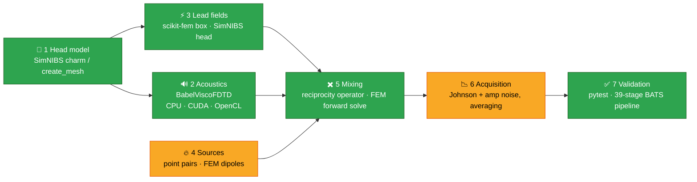

<div align="center">

# 🔊⚡🧠 ae-sim

### Acoustoelectric neuroimaging, simulated end to end

*Can a focused ultrasound beam turn scalp electrodes into a millimetre-resolution current imager?*
*This repository is the attempt to answer that with physics, open solvers and open data.*

[](#-where-things-stand)
[](LICENSE)
[](docs/running.md)
[-success?style=for-the-badge)](docs/research/05-prototype-findings.md)
[](pyproject.toml)
[](https://github.com/astral-sh/uv)
[](https://copr.fedorainfracloud.org/coprs/mhough/neurofedora/)
[](docs/running.md#container-on-the-dgx-spark-alternative-to-legion)

[**Research notes**](docs/research/README.md) ·
[**Running it**](docs/running.md) ·
[**Roadmap**](docs/research/06-roadmap.md) ·
[**References**](docs/research/references.md)

</div>

---

## 🧪 The idea

Pressure changes conductivity. A focused ultrasound pulse sweeping through tissue modulates
its conductivity by a tiny fraction, Δσ/σ₀ = −K ΔP, and so *tags* whatever current is flowing
where the pulse is. A recording electrode pair sees, by reciprocity,

$$V_{AE}(t) = -K \int \Delta P(\mathbf r, t)\,\rho_0\, \mathbf J_L(\mathbf r)\cdot \mathbf J_I(\mathbf r)\, dV$$

where **J_L** is the lead field of the pair (current density per ampere injected through it)
and **J_I** is the current being imaged, neural or injected. Scan the focus and you have an
image of current density at ultrasound resolution. The same physics, run the other way, lets
an ultrasound beam and an applied field *produce* a localised low-frequency field inside the
brain (acoustoelectric heterodyning / neuromodulation).

Both the imaging mode and the heterodyning mode are built from the same seven blocks, and
each block here is an open solver already packaged for Fedora in the
[mhough/neurofedora COPR](https://copr.fedorainfracloud.org/coprs/mhough/neurofedora/).



<sub>🟩 implemented · 🟨 partial · ⬜ not yet. Skull acoustics, neural population sources
(LFPykit) and matched-filter receive models are the open blocks.</sub>

---

## 📚 The research so far

The notes under [`docs/research/`](docs/research/README.md) are the substance of this repo.
Here is the short version.

### 🎯 1. Which published experiments can we replicate? → [note 01](docs/research/01-replication-targets.md)

The **Witte / O'Donnell line** reports absolute sensitivities, which is exactly what a simulator
can be scored against:

| target | setup | the number to hit |
|---|---|---|
| 🥇 Preston 2018 | Medtronic DBS contacts in saline, 1 MHz | **0.52 µV / (mA·MPa)** |
| 🥈 Kang 2023 + Cheong 2026 | dipole in an 8 cm saline cube, 18 × 7 array at 0.6 MHz, 3-axis leads | COMSOL / Field II / k-Wave maps |
| 🥉 Allard 2025 + Barragan 2020 | human skull + gel, depth electrode, 126-element array | **1.5 µV / mA at 0.7 MPa**, 4.7 × 7.9 × 4.5 mm resolution |

**Target 1 is done.** With the Medtronic 3389 geometry, an idealised 1 MHz beam and K = 0.1 %/MPa,
`examples/dbs_lead_saline.py` gives **0.47 µV / (mA·MPa)** against the measured 0.52, puts the
peak 0.43 mm from the stimulating contact (paper: within 0.41 mm) and an axial extent of 3.09 mm
(paper 3.11). The match only appeared once the two solves saw the real circuits: the stimulating
contact is a sink at 1 MHz (generator output) and the idle contacts are open at 200 Hz (double
layer). Replacing the Gaussian beam with a BabelViscoFDTD run of the paper's transducer
(`AE_SIM_BEAM=fdtd`) gives **0.83 µV / (mA·MPa)**, the peak 0.10 mm from the contact and a
3.25 mm beam at the lead: the two beams bracket the measurement, and the coupling constant is
the open question. At the 0.034 %/MPa Witte's group quotes both are low, the same direction as
the Rintoul gap.

### 🐭 2. The Rintoul experiments → [note 02](docs/research/02-rintoul-heterodyning-and-in-vivo.md)

Three papers from Imperial with the most completely specified open setups: a 500 kHz bowl in a
PVDF-split tank, in vivo mouse neuromodulation (**~9 mV, ~6 V/m** at the focus) and neural
recording. The 2023 solver and tank simulations are public. The headline puzzle: their
simulation with K = 1e-9 falls **20–40× short** of the tank measurement, and the published
code hard-codes K = 2e-8 to compensate. Our own prototype found a ×5 boundary gain and a ×4
near-field correction, which together span that gap without touching K. Testing whether
geometry closes it is the first end-to-end replication on the list.

### 🐀 3. Open rodent head models make the in vivo papers reachable → [note 03](docs/research/03-rodent-head-models.md)

| dataset | species | skull? | licence |
|---|---|---|---|
| **SIGMA v2** | Wistar rat, whole head, GM/WM/CSF/skull maps, CT space | ✅ | CC BY 4.0 |
| **Digimouse** | mouse CT + cryosection at 0.1 mm, skeleton/brain/skin labels, FEM meshes | ✅ | free with citation |
| Waxholm SD | rat brain at 39 µm | ❌ | open |
| Toronto NeuroMouse | C57Bl/6J head, complete skull (MINC) | ✅ | unstated |

SimNIBS 4.6's `create_mesh` builds a tetrahedral head from *any* labelled volume, and
BabelViscoFDTD takes any material grid, so a rat or mouse volume conductor plus skull
acoustics comes out of the existing toolchain. That brings Rintoul's in vivo mouse numbers
and the Tianjin rat DBS mapping within reach.

### 📏 4. The coupling constant is not settled → [note 04](docs/research/04-coupling-constant.md)

| source | K |
|---|---|
| this code (hard-coded) | 0.10 % / MPa |
| Witte group | 0.034 % / MPa |
| Wang 2026, measured, saline / porcine brain | 0.024 / 0.022 % / MPa |
| Rintoul 2023, needed to fit the tank | 2 % / MPa |

Under the measured values our real-head estimates shrink ~4×. K is now a parameter
(`AE_SIM_K=witte`, `wang-brain`, `0.034%/MPa`, ...), every result records the K it used, and
injected-current examples report µV / (mA·MPa).

### 🔬 5. What the prototype itself has taught us → [note 05](docs/research/05-prototype-findings.md)

- 🚫 **A radiated pulse has no DC.** The AE trace is the coupling *band-pass filtered by the
  pulse spectrum*: smooth currents show only through their axial gradients, mm-scale
  structure shows directly. CW and long bursts image gradients only.
- 🧱 **Boundaries matter.** A finite insulated bath raises the signal ~5×; the FDTD near field
  is ~4× above an ideal beam.
- 🧠 **Real head (ernie):** a 20 nA·m cortical dipole 15 mm under C3 at 0.3 MPa gives
  32 pV at 1 MHz and 268 pV at 0.25 MHz on a C3-C4 scalp pair. Lower ultrasound frequency is the
  strongest lever; a nearer scalp pair does not help because the skull sets the lead field.
- 🧮 **Mesh granularity** adds a 1.5–3× model uncertainty to real-head numbers at high frequency.
- 🔌 **Circuits matter as much as fields.** Whether an electrode is a floating conductor, a sink or
  open at each of the two frequencies decides where the AE peak sits and whether it cancels.
- 🧭 **The beam's orientation to the stimulation field matters in heterodyning mode.** The FEM
  forward path (`ae_sim.forward`) solves for the AE potential everywhere; inside the focal spot
  the volume conductor cancels a fraction N of the local modulation K·P·E₀, with N the
  depolarisation factor of the spot shape: ~0.04 with the beam along E₀, ~0.4 across it
  (a factor of two in the AE current, before any tissue heterogeneity).

---

## 📊 Where things stand

| | |
|---|---|
| 🧩 blocks | 5 of 7 implemented, 2 partial |
| ✅ tests | pytest suite + 39-stage BATS pipeline (26 = the Rintoul tank cross-check incl. their k-space outputs, 36 = the Preston replication, 37 = the FEM forward path, 38 = Preston with the FDTD beam, 39/41 = the Digimouse head, body and painted-head models with the neural readout, 42/46 = the skull in the acoustic path (atlas bone, then thinned to 0.3 mm), 43 = the cone artefact, 44/45/47 = the SIGMA rat head, the DBS mapping case and the rat skull at 1 MHz, 48 = the Hodgkin-Huxley onset response, 49/50/51 = the CAD lead cut out by gmsh: the same electrode under two meshers, a round 0.25 mm lead, and the bipolar lead that the scalp barely sees, 52/53 = the pulse itself through the rat skull and the AE trace in time, at 1 MHz and (opt-in) 0.5 MHz), green on CPU |
| 🖥️ hosts | AMD NUC (dev, CPU), legion (RTX 2080, CUDA), **DGX Spark** (aarch64 GB10, production, container) |
| 📦 stack | `python3-simnibs 4.6`, `python3-babelviscofdtd 1.2.7` from the COPR, `python3-gmsh 4.15` and `python3-mumps` from Fedora (the CAD lead, the direct-solver backend), scikit-fem, numpy/scipy via `uv` |
| 📝 next | the DOLFINx Helmholtz model with air (assemble in dolfinx, solve with MUMPS; needs `python3-dolfinx-openmpi` on a box I can use) · air around the mouse head (Babel diverges on the voxelised boundary) · the Tianjin transducer, pulse and montage parameters once the methods are in hand (the electrode is excluded: 0.25–1 mm leads give 19–30 µV / (V·MPa), a 0.125 mm wire 11, and a bipolar return drops it to 0.6) · ask the 2023 authors about the factor 35 (the oil/PVDF side is now in the tank box and changes nothing) |

Full checklist: [docs/research/06-roadmap.md](docs/research/06-roadmap.md).

---

## 📦 Data and resources

Everything the examples and the planned tutorials read, with its licence and size. Policy
(decided 2026-10-23): **no multi-hundred-megabyte data goes into the COPR**; large files are
fetched by checksummed scripts in `scripts/` (pattern: `scripts/fetch-ernie.sh`), and only
small, redistributable items ride along in packages. The survey behind this table is
[docs/research/07-data-and-tutorials.md](docs/research/07-data-and-tutorials.md).

| resource | what it is | licence | size | how we get it |
|---|---|---|---|---|
| [SimNIBS `ernie`](https://github.com/simnibs/example-dataset) | low-res human head (m2m folder) used by `examples/head_feasibility.py` | CC BY-NC 4.0 | 413 MB | `scripts/fetch-ernie.sh` (sha256 pinned); nonfree, never packaged in the free COPR |
| [Digimouse](https://neuroimage.usc.edu/neuro/Digimouse) | 0.1 mm whole-body mouse label volume (`atlas.zip`) and a 58 k-node / 307 k-tet labelled tetrahedral mesh (`tesselated_atlas.zip`) that loads straight into `AEForwardSolver` | CC BY-SA 4.0 | 0.9 + 4.2 MB | `scripts/fetch-digimouse.sh` (sha256 pinned); `ae_sim.digimouse` loads both, `ae_sim.mousehead` paints gel, loops and an oral cavity into the volume and meshes it with SimNIBS; tutorial 1 = `examples/digimouse_head.py` (stages 39 and 41); small enough for a `digimouse-data` package |
| [SIGMA v2 rat](https://zenodo.org/records/10635831) | Wistar rat whole-head ex vivo template, tissue and skull probability maps, CT template, atlases | CC BY 4.0 | 1.5 GB | `scripts/fetch-sigma.sh` (md5 pinned); `ae_sim.sigma_rat` classifies air / soft / CT skull / CSF / GM / WM at 0.18 mm, paints a DBS lead to an atlas target and meshes it (stage 44) or cuts a CAD lead out of it with gmsh (`ae_sim.leadmesh`, stages 49–50); `examples/sigma_rat_dbs.py` is the Tianjin-line DBS mapping case (stage 45) |
| [Rintoul 2023 tank data](https://doi.org/10.6084/m9.figshare.c.6365098) | k-space pressure field (`pressure0.5MHz.npz`) and AE outputs (`ae_data_kspace_a{0,90}degrees_f0.5MHz.npz`), measured streams (`df10hz_stream.npy`, `df492khz_stream.npy`, `12.0_demod_8_stream.npy`), four field GIFs | CC BY 4.0 | 229–653 MB each; 32 MB; 11–19 MB | `scripts/fetch-rintoul-2023.sh [DATA] [pressure demod gifs kspace streams all]` (md5 pinned, default: the 229 MB pressure field, the 32 MB stream, the GIFs); `examples/rintoul_tank.py` (stage 26) runs their pressure field through our solver |
| [Rintoul 2023 code](https://doi.org/10.6084/m9.figshare.21804039) | `kspace_solver.py`, `focused.m`, demodulation and plotting scripts | **CC BY-NC-SA 4.0** inside the archive (the Figshare record says CC BY 4.0) | 7.4 MB | read, never copied; our solvers are re-derived from the papers |
| [Rintoul 2026 neuromodulation data](https://doi.org/10.6084/m9.figshare.c.7909283) | figure data (F2–F8, Supp 9) and analysis code | CC BY 4.0 data, Apache-2.0 code | 49 MB – 1.05 GB per figure | fetch script per figure (planned) |
| [Rintoul 2026 recording example](https://doi.org/10.6084/m9.figshare.c.7754537) | single-shot AE neural recording with acoustic-isolation control (`ae.npy`, `ac_iso.npy`) | CC BY 4.0 | 480 + 480 MB | fetch script (planned) |
| Preston 2018 · Barragan 2020 · Allard 2025 · Kang 2023 · Cheong 2026 | no data deposits (supplementary movies only) | journal copyright | — | parameters tabulated in [note 01](docs/research/01-replication-targets.md); our replications stand in for the data |
| [mhough/neurofedora COPR](https://copr.fedorainfracloud.org/coprs/mhough/neurofedora/) | `python3-babelviscofdtd`, `python3-simnibs`, the rest of the solver stack | various (free) | — | `dnf install` |

Figshare download URLs (`https://ndownloader.figshare.com/files/<id>`) redirect to short-lived
signed links, so the fetch scripts pin the file id and the sha256, not the final URL. Each
dataset keeps its own licence and citation beside the files it fetches.

---

## 🚀 Quick start

```sh
sudo dnf install python3-babelviscofdtd python3-simnibs bats      # mhough/neurofedora COPR
uv venv --system-site-packages --python /usr/bin/python3 && uv sync
uv run pytest -q                                                   # ~70 s
scripts/run-pipeline.sh                                            # the whole thing, ~9 min on CPU
```

GPU (`uv sync --extra gpu`, `AE_SIM_BACKEND=cuda`), the example head, environment variables,
and the all-in-one container for the DGX Spark (`scripts/container-run.sh build|smoke|run|head`)
are documented in [docs/running.md](docs/running.md).

## 🗂️ Layout

```
src/ae_sim/      acoustics · leadfield · forward · dbs · coupling · head · gridfield · sources · fields · mixing · noise · report
examples/        saline_scan · babel_fem_phantom · dipole_feasibility · head_feasibility · dbs_lead_saline · ae_field_map · digimouse_head · rintoul_tank
tests/           pytest units + pipeline.bats (39 stages, numbers asserted against CPU baselines)
scripts/         run-pipeline · fetch-ernie · fetch-digimouse · fetch-rintoul-2023 · fetch-sigma · container-run · bundle-for-legion · gpu_vs_cpu
docs/research/   the research notes summarised above
docs/running.md  operational guide
Containerfile    fedora:44 + COPR solvers + uv venv, x86_64 and aarch64
```

## 📜 Licence

Apache-2.0 (see [LICENSE](LICENSE)). The cited solvers and datasets keep their own licences;
the Rintoul 2023 k-space solver (CC BY-NC-SA 4.0) is referenced, not copied.

## 🙏 Acknowledgements

Built on [SimNIBS](https://simnibs.github.io/simnibs/), [BabelViscoFDTD](https://github.com/ProteusMRIgHIFU/BabelViscoFDTD),
[scikit-fem](https://github.com/kinnala/scikit-fem) and the open experimental work of the
Witte, O'Donnell, Grossman / Rintoul and Tianjin groups cited in
[docs/research/references.md](docs/research/references.md). Packaged for Fedora through
[NeuroFedora](https://neuro.fedoraproject.org/).

<div align="center">
<sub>Morgan Hough · prototype, numbers subject to the K caveat above · developed with Claude Code</sub>
</div>
